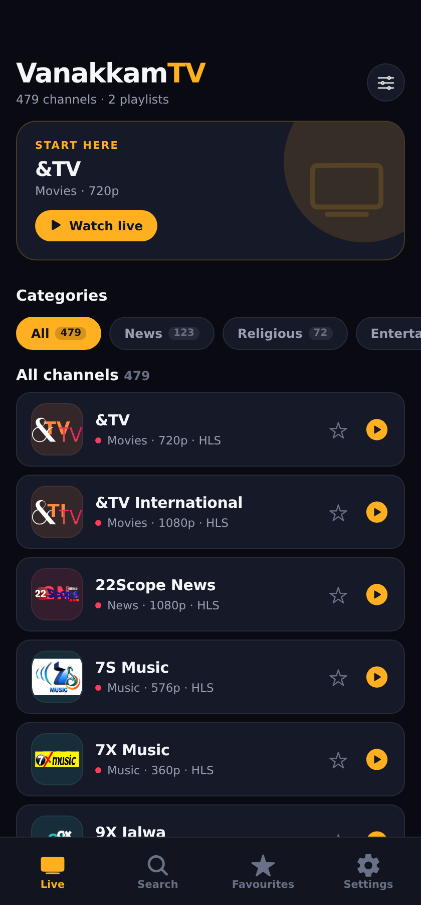
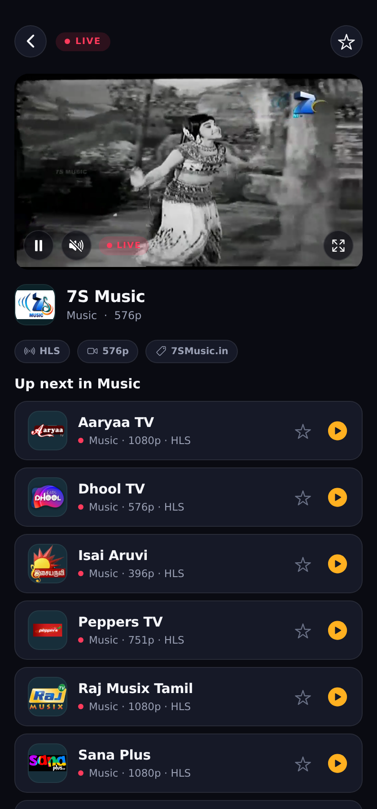
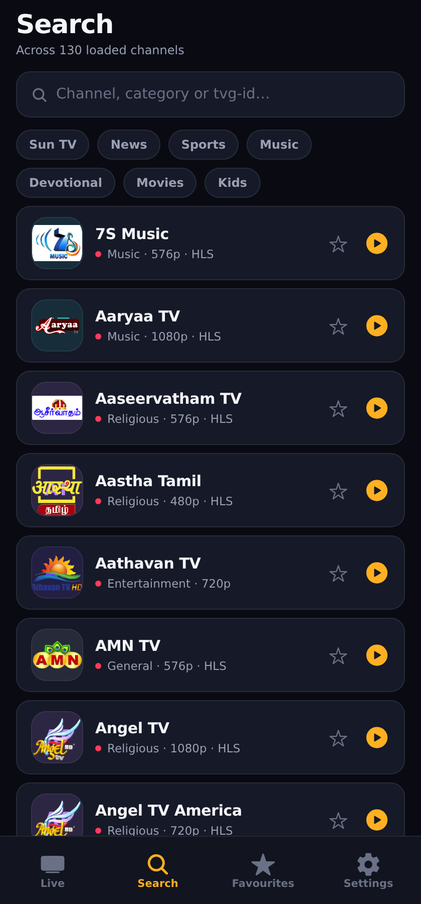
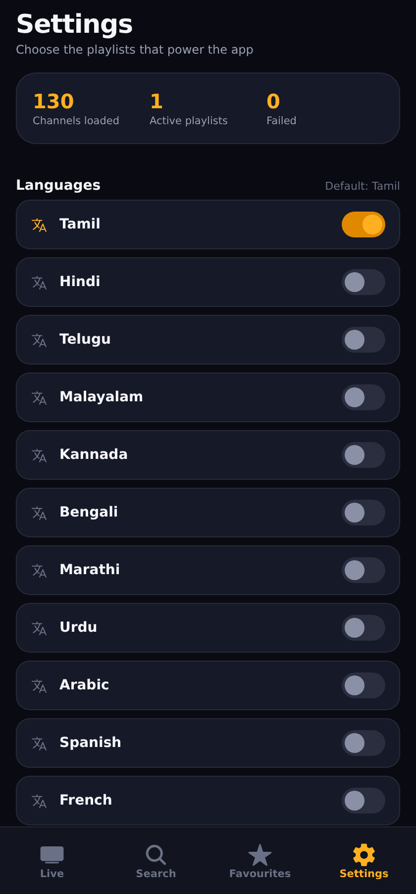

# Vanakkam TV 📺

A clean, dark-mode **live TV streaming app** built with **Expo (React Native)** on top of
[`iptv-org/iptv`](https://github.com/iptv-org/iptv) — a collection of publicly available
IPTV channels from all over the world.

**Tamil is the default playlist**, all other languages/categories/countries are one switch
away in Settings. Runs on **iOS, Android and web** from a single codebase.

| Live | Player | Search | Settings |
|---|---|---|---|
|  |  |  |  |

---

## Why this exists

`iptv-org/iptv` publishes ~11,000 free, publicly-listed channels as daily-refreshed M3U
playlists. Those files are raw text — great for VLC/Kodi, not usable on a phone. This app
turns them into a real product: a browsable, searchable, favouritable TV guide with a
player that actually handles HLS.

Nothing is bundled. Playlists are fetched at runtime from GitHub Pages, so the channel
list is always current.

## Features

- 🇮🇳 **Tamil by default** — cold start shows the Tamil playlist (130 channels), everything
  else is optional
- 🌍 **Multi-playlist** — mix Tamil + Hindi + Telugu + News + India… channels are merged,
  de-duplicated and sorted
- 🔎 **Instant search** across every loaded channel (name, category, tvg-id)
- ⭐ **Favourites + recently watched**, persisted with AsyncStorage
- 🎬 **Real HLS playback** — `expo-video` on native, `hls.js` on web (Chrome/Firefox can't
  play `.m3u8` natively)
- 🧩 **Graceful failures** — per-stream retry UI, per-playlist error reporting, short
  auto-retry loop while a stream connects
- 🎨 **Clean UI** — dark "night cinema" palette, marigold accent, auto-generated monogram
  logos for channels with no artwork

## Project layout

```
vanakkam-tv/
├── app/
│   ├── _layout.js          # Stack: (tabs) + full-screen watch route
│   ├── (tabs)/
│   │   ├── _layout.js      # Tab bar: Live · Search · Favourites · Settings
│   │   ├── index.js        # Home: hero, category chips, channel list
│   │   ├── search.js
│   │   ├── favorites.js
│   │   └── settings.js     # Playlist picker (the source of truth)
│   └── watch.js            # Player screen + "up next"
├── components/
│   ├── Player.js           # native player (expo-video)
│   ├── Player.web.js       # web player (hls.js + <video> + custom controls)
│   ├── ChannelCard.js
│   ├── ChannelLogo.js      # monogram fallback
│   ├── CategoryChips.js
│   ├── EmptyState.js
│   └── ScreenHeader.js
├── lib/
│   ├── m3u.js              # dependency-free M3U/M3U8 parser
│   ├── playlists.js        # iptv-org source list + loader
│   └── storage.js          # AsyncStorage helpers
├── store/AppContext.js     # channels, sources, favourites, history
└── theme.js                # design tokens
```

## Run it

```bash
cd vanakkam-tv
npm install

npm run web        # browser at http://localhost:8081
npm run android    # Android emulator / device via Expo Go
npm run ios        # iOS simulator (macOS)
```

Or scan the QR from `npx expo start` with **Expo Go**. To put it on a real device as a
standalone binary:

```bash
npx expo run:android      # needs Android SDK
npx expo run:ios          # needs Xcode on macOS
# or, cloud builds:
eas build -p android --profile preview
```

### Add your own playlist

`lib/playlists.js` is just an array. Append an entry:

```js
{
  id: 'my-list',
  label: 'My playlist',
  kind: 'language',          // language | category | country | all
  url: 'https://example.com/my.m3u',
  emoji: '📺',
  default: true,             // optional: select on first launch
}
```

Any standard M3U/M3U8 works — the parser also reads `#EXTVLCOPT` `http-user-agent` /
`http-referrer` hints, which many IPTV CDNs require.

## How the data flows

```
iptv-org.github.io/iptv/languages/tam.m3u
        │  fetch (runtime, 20s timeout per source)
        ▼
lib/m3u.js  ──►  Channel objects { name, url, logo, categories, quality, isHls … }
        │
        ▼
store/AppContext.js  ──►  dedupe + sort + merge across playlists
        │
        ▼
Live / Search / Favourites  ──►  /watch  ──►  Player (expo-video | hls.js)
```

## Good to know

- **These are public, unofficial streams.** Many are geo-blocked, rate-limited or simply
  dead. The player shows an error with a *Retry* button instead of hanging, but no app can
  guarantee uptime for this kind of source.
- **CORS on web.** Some streams refuse cross-origin requests in a browser even though they
  play fine in VLC or on native. That's a per-server decision — native builds are not
  affected.
- **Legal.** iptv-org only indexes streams that are publicly available; the repo carries an
  explicit DMCA/takedown policy. Check your local rules before redistributing anything.
- **Licence.** App code here: MIT. Playlists & channel metadata belong to their owners;
  see the [iptv-org licence and disclaimer](https://github.com/iptv-org/iptv#legal).
